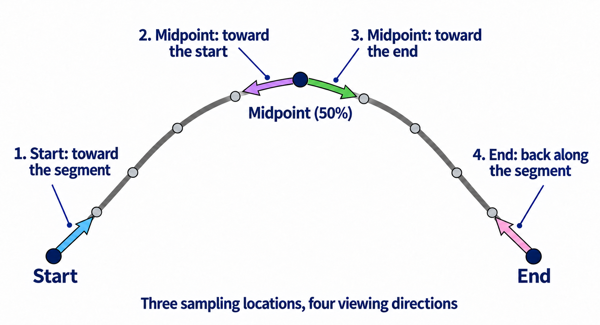
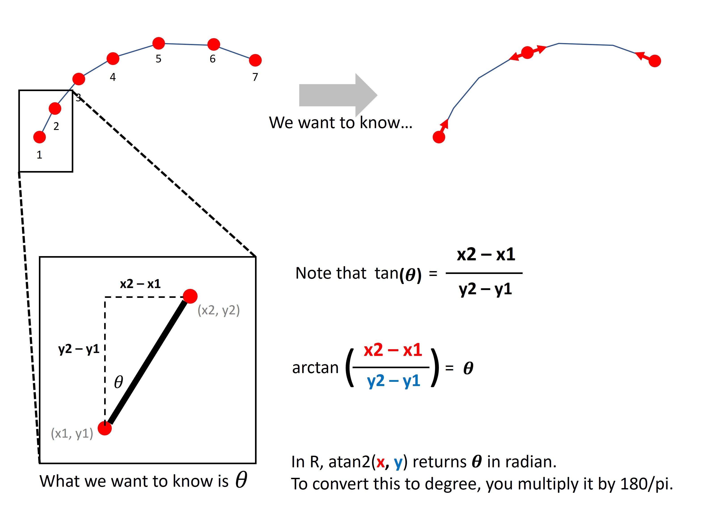

<style type="text/css">
  body{
  font-family: Arial;
  }
</style>

```{r message=F, warning=F}
knitr::opts_chunk$set(message = FALSE, warning = FALSE)

library(tidyverse)
library(magrittr)
library(osmdata)
library(sfnetworks)
library(sf)
library(tidygraph)
library(tmap)
ttm()

```


# Introduction

In this module, we want to collect Google Street View (GSV) images from a city of your choice, apply a semantic segmentation model to those images, and examine how the results vary across different road types.

In this lab session, our main task is to collect the images. Specifically, we will sample points from a road network, prepare the location data (i.e., coordinates and headings), and then download the images.

# Step 1. Select a study area.

Choose a city you like. It can be any U.S. city, or even one anywhere in the world. OSM uses the same `highway` tags across countries, although the interpretation and availability of road classes can vary.

I recommend picking a big city like Atlanta so that we have enough segments for each road type. We will sample up to 50 segments per road type to limit the number of image requests.

Make sure Google Street View covers your chosen city. The example uses Atlanta and EPSG:32616. If you choose another city, set `local_crs` to a suitable local projected CRS with meter units. We use it for lengths and point sampling, then convert the sampled locations to longitude and latitude for Google.

Choose one bounding-box option below: for a U.S. city, we will use a Census boundary from `tigris`; otherwise, geocode the city and extract its bounding box. Comment out the option you are not using.

```{r message=F, warning=F}
# Bounding Box for the city you chose.
## Option 1 (US only)
my_bb <- tigris::places(state = ????) %>% 
  filter(NAME == ????) %>%
  st_bbox()

## Option 2: For a non-US city, `tigris` is not available. Use `nominatimlite` instead.
# my_bb <- nominatimlite::geo_lite_sf(????, points_only = FALSE) %>% st_bbox()

local_crs <- ????
```


# Step 2. Get OSM data and clean it.

## 2-1. Download OSM.

Query the OSM road network data, then apply the edge-cleaning methods from the OSM lab: remove multiple edges and loops and subdivide edges at missing intersections. Preserve road-class changes when smoothing so our road-type comparisons retain their meaning.

```{r message=F, warning=F}
# Get OSM data.
set_overpass_url("https://overpass-api.de/api/interpreter")

osm_road <- opq(bbox = ????, timeout = 180) %>%
  add_osm_feature(key = ????, 
                  value = c("motorway", "trunk", "primary", 
                            "secondary", "tertiary", "residential")) %>%
  osmdata_sf() %>% 
  osm_poly2line()

# Convert the OSM lines to sfnetwork and clean it.
net <- osm_road$osm_lines %>% 
  st_transform(local_crs) %>%
  select(osm_id, highway) %>% 
  sfnetworks::as_sfnetwork(directed = FALSE) %>% 
  activate(????) %>%
  filter(????) %>% # remove duplicated edges
  filter(????) %>% # remove loops
  convert(., ????) %>% # subdivide edges
  convert(., sfnetworks::to_spatial_smooth, require_equal = "highway", summarise_attributes = "first") # delete pseudo nodes
```


## 2-2. Extract edges.

Extract the edges from the cleaned, projected road network, calculate lengths in meters, and remove segments shorter than 300 feet (91.44 meters). Sample up to 50 segments per road type, then assign a unique `edge_id` to each sampled segment. A road type with fewer eligible segments contributes all of its segments.

To avoid excessive API calls, we will sample **up to 50 segments per road type**, so that the total number of API calls does not exceed *1,200* (6 road types X 50 segments X 4 images per segment).

```{r}
set.seed(123) # for reproducibility
edges <- net %>% 
  # Extract 'edges'
  st_as_sf("edges") %>% 
  # Drop redundant columns 
  select(osm_id, highway) %>% 
  # Add a length column
  mutate(length = as.numeric(st_length(.))) %>% 
  # Drop short segments (< 300 feet)
  filter(length >= 91.44) %>% 
  # Sample 50 rows per road type
  group_by(highway) %>% 
  slice_sample(n = 50) %>% 
  # Assign a unique ID for each edge
  ungroup() %>% 
  mutate(edge_id = seq(1,nrow(.)))

table(edges$highway)

tm_shape(edges) + tm_lines(col = "highway")
```

> Now, the total number of rows in the `edges` object multiplied by 4 is essentially the number of API calls we will make.

# Step 3. Get coordinates and headings.

We will download four images per street segment: one at the start, two at the midpoint, and one at the end. But a street segment is not necessarily straight. To point each camera along the road, we need to calculate its direction near that location rather than use the direction between the segment's endpoints.



Let's select one sampled segment and examine its shape. We will calculate its four camera headings in the next section, then compare them with the road on the map. You can change `test_edge_n` to examine another sampled segment.

```{r}
# Select an edge for illustration
test_edge_n <- 1
test_edge <- edges %>% 
  filter(edge_id == test_edge_n) %>% 
  st_geometry()

test_edge %>%
  with(
    tm_basemap("OpenStreetMap") +
      tm_shape(.) + tm_lines(lwd = 5, col = "red")
  )
```

## 3-1. Sample points and get heading.

A heading is measured clockwise from north: 0 degrees is north, 90 east, 180 south, and 270 west. We approximate it from changes in projected X and Y using `atan2(change_in_X, change_in_Y) * 180 / pi`. This converts radians to degrees; `%% 360` places the result between 0 and 360. These local grid headings are an approximation to compass bearings.

The diagram below shows how changes in X and Y give the angle measured from north. This is the calculation we apply to a short part of the road near each camera location.



For the start point, look from the first coordinate toward the second. For the end point, first calculate the direction from the next-to-last coordinate toward the last, then reverse it by 180 degrees to look back along the segment. The two midpoint headings look toward the points at 48% and 52% of the segment length. Only the midpoint (50%) is an image location; the points at 48% and 52% are used only to determine the two viewing directions. Use the row indices in the coordinate matrices to fill the blanks below.

```{r}
# -----------------------------------------------------------
# Start of the segment: first two coordinates
start_p <- test_edge %>% 
  st_coordinates() %>% 
  .[1:2,1:2]

# Calculate the heading
start_heading <- atan2(start_p[????,"X"] - start_p[????, "X"],
                   start_p[????,"Y"] - start_p[????, "Y"])*180/pi # 180/pi because trigonometry in R takes radians

# -----------------------------------------------------------
# End of the segment: last two coordinates
end_p <- test_edge %>% 
  st_coordinates() %>% 
  .[(nrow(.)-1):nrow(.),1:2]

# Calculate the heading
end_heading <- atan2(end_p[????,"X"] - end_p[????, "X"],
                 end_p[????,"Y"] - end_p[????, "Y"])*180/pi

# Keep the start heading between 0 and 360
start_heading <- start_heading %% 360

# Flip the heading so that the camera would be looking back
end_heading <- (end_heading + 180) %% 360

# ----------------------------------------------------------
# mid point
mid_p3 <- test_edge %>% 
  .[[1]] %>% 
  st_line_sample(sample = c(0.48, 0.5, 0.52)) %>% # 0.48 and 0.52 are for heading calculation
  st_cast("POINT") %>% 
  st_coordinates()

mid_p <- mid_p3[2,]

mid_heading_1 <- atan2(mid_p3[1,"X"] - mid_p3[2, "X"],
                   mid_p3[1,"Y"] - mid_p3[2, "Y"])*180/pi

mid_heading_2 <- atan2(mid_p3[3,"X"] - mid_p3[2, "X"],
                   mid_p3[3,"Y"] - mid_p3[2, "Y"])*180/pi

mid_heading_1 <- mid_heading_1 %% 360
mid_heading_2 <- mid_heading_2 %% 360

```


The headings below are in degrees. Do they match the segment directions?
<span style="color: lightblue;">`r round(start_heading, 1)`</span>;
<span style="color: orchid;">`r round(mid_heading_1, 1)`</span>;
<span style="color: green;">`r round(mid_heading_2, 1)`</span>;
<span style="color: pink;">`r round(end_heading, 1)`</span>

The colored lines below show the nearby coordinate pairs used to calculate each heading. Compare their directions with the curved-road diagram above.

```{r}
tm_basemap("OpenStreetMap") + 
  tm_shape(test_edge) + tm_lines(lwd = 3) +
  tm_shape(st_linestring(start_p) %>% st_sfc(crs = st_crs(test_edge))) + tm_lines(col = "lightblue", lwd = 8) +
  tm_shape(st_linestring(mid_p3[1:2,]) %>% st_sfc(crs = st_crs(test_edge))) + tm_lines(col = "orchid", lwd = 8) +
  tm_shape(st_linestring(mid_p3[2:3,]) %>% st_sfc(crs = st_crs(test_edge))) + tm_lines(col = "green", lwd = 8) +
  tm_shape(st_linestring(end_p) %>% st_sfc(crs = st_crs(test_edge))) + tm_lines(col = "pink", lwd = 8)
```


## 3-2. Define a function.

Now put the same calculations into `getHeading()`. The input is one projected LINESTRING. The function returns four rows, one for each view, with its location and heading. The start and end calculations use the same coordinate-row choices as above.
```{r}
getHeading <- function(line){
  # end point 1 ----------------------------------------------
  start_p <- line %>% 
  st_coordinates() %>% 
  .[1:2,1:2]

  start_heading <- atan2(start_p[????,"X"] - start_p[????, "X"],
                     start_p[????,"Y"] - start_p[????, "Y"])*180/pi
  
  # end point 2 ----------------------------------------------
  end_p <- line %>% 
    st_coordinates() %>% 
    .[(nrow(.)-1):nrow(.),1:2]
  
  end_heading <- atan2(end_p[????,"X"] - end_p[????, "X"],
                   end_p[????,"Y"] - end_p[????, "Y"])*180/pi
  
  end_heading <- (end_heading + 180) %% 360
  
  # mid point 1 ---------------------------------------------
  mid_p3 <- line %>% 
    st_line_sample(sample = c(0.48, 0.5, 0.52)) %>% 
    st_cast("POINT") %>% 
    st_coordinates()
  
  mid_p <- mid_p3[2,]
  
  mid_heading_1 <- atan2(mid_p3[1,"X"] - mid_p3[2, "X"],
                     mid_p3[1,"Y"] - mid_p3[2, "Y"])*180/pi
  
  mid_heading_2 <- atan2(mid_p3[3,"X"] - mid_p3[2, "X"],
                     mid_p3[3,"Y"] - mid_p3[2, "Y"])*180/pi
  
  start_heading <- start_heading %% 360
  mid_heading_1 <- mid_heading_1 %% 360
  mid_heading_2 <- mid_heading_2 %% 360

  # return in data frame ------------------------------------
  return(tribble(
    ~type,     ~X,             ~Y,             ~heading,
    "start",   start_p[1,"X"], start_p[1,"Y"], start_heading,
    "mid1",    mid_p["X"],     mid_p["Y"],     mid_heading_1,
    "mid2",    mid_p["X"],     mid_p["Y"],     mid_heading_2,
    "end",     end_p[2,"X"],   end_p[2,"Y"],   end_heading))
}
```


## 3-3. Apply the function to `edges`.

Apply `getHeading()` to every sampled segment. Each call returns four rows, so repeat each segment's attributes four times before combining them with the sampled points. Create the points using `local_crs`, then transform them to EPSG:4326. Google expects longitude/latitude coordinates, not projected coordinates.

`edge_id` identifies the street segment; `img_id` uniquely identifies each requested image. The four views of a segment share an `edge_id` but have different `img_id` values. Keep these columns unchanged so the segmentation results from the next lab session can be joined back to these locations.

```{r message=F, warning=F}
edges_heading <- edges %>% 
  st_geometry() %>% 
  map_df(getHeading, .progress = T)

edges_heading %<>% 
  bind_cols(edges %>% 
              st_drop_geometry() %>%
              slice(rep(1:nrow(edges),each=4))) %>% 
  st_as_sf(coords = c("X", "Y"), crs = local_crs) %>%
  st_transform(4326) %>%
  # X and Y contain longitude and latitude, respectively.
  mutate(X = st_coordinates(.)[, "X"],
         Y = st_coordinates(.)[, "Y"],
         heading = heading %% 360,
         img_id = seq_len(nrow(.)))

edges_heading
```


> Export `edges_heading` with `st_write()` to a filename `edges_heading.geojson`. Keep this file: the final R lab joins Colab results to these exact sampled locations. Do not regenerate or renumber the points after downloading the images.

```{r}
edges_heading %>% st_write(????)
```


# Step 4. Get GSV images.

Now that we have prepared the data for the GSV API parameters (coordinates and headings), we can proceed to download the images.

## 4-1. Define a function.

First define a function that formats the request URL and downloads one image. Use your Google API key saved as an environment variable, as in the earlier API lab. The endpoint is `https://maps.googleapis.com/maps/api/streetview`. The API expects location as latitude,longitude (`Y,X`), and heading in degrees. Keep the filename format unchanged because Colab extracts the image ID from it.

Create a folder named `downloaded_image` in your working directory before downloading. Use `file.path()` to combine that folder with `fname` for the output path. The request below uses 640-by-640 images, a 90-degree field of view, and a level camera (`pitch=0`). Google uses the nearest available panorama, so the actual camera location can differ from the requested point. See the [Street View Static API documentation](https://developers.google.com/maps/documentation/streetview/request-streetview).

```{r}
getImage <- function(iterrow){
  type = iterrow$type
  location <- paste0(iterrow$Y %>% round(5), ",", iterrow$X %>% round(5))
  heading <- iterrow$heading %>% round(1)
  edge_id <- iterrow$edge_id
  img_id <- iterrow$img_id
  highway <- iterrow$highway
  key <- Sys.getenv(????) # your Google API key
  
  endpoint <- ????
  
  request <- glue::glue("{endpoint}?size=640x640&location={location}&heading={heading}&fov=90&pitch=0&key={key}")
  fname <- glue::glue("GSV-img_{img_id}-eid_{edge_id}-type_{type}-Location_{location}-heading_{heading}-highway_{highway}.jpg")
  fpath <- ???? # Full output path, including the image filename
  download.file(request, fpath, mode = 'wb', quiet = TRUE)
  
  Sys.sleep(1)
}
```


## 4-2. Download the images.

Now let's use `getImage()` to download a test image. If it looks correct, we'll apply the function to all rows in `edges_heading`.

```{r message=F}
dir.create("downloaded_image", showWarnings = FALSE)

# First test one image; then run the loop below.
getImage(edges_heading[1, ])
```

> Open the downloaded image and check that it shows a valid street view. If it looks correct, proceed with the full download loop below.

The loop processes rows of `edges_heading`, not rows of `edges`: each segment has four image requests. Use the number of rows in `edges_heading` for both the progress-bar maximum and the loop limit. First download and open one image to check your key, output folder, and image coverage before running the full loop.

Always monitor your usage and stay well below the [free monthly allowance of 10,000 Static Street View image requests](https://developers.google.com/maps/billing-and-pricing/pricing) (as of November 2026). Repeated downloads count toward this allowance.
  
<span style="color: pink; font-weight: bold;">This process can take more than 30 minutes (roughly 3 minutes per 100 images).</span>

```{r message=F}
# Create a progress bar to monitor progress
pb <- txtProgressBar(min = 0, max = ????, style = 3)

# Loop through each segment to download images
for (i in seq(1, ????)){
  getImage(edges_heading[i,])
  setTxtProgressBar(pb, i)
}
close(pb)
```

> Inspect the downloaded images and remove any gray "no imagery" placeholders or invalid files before running the model. Then zip the folder as `gsv_images.zip` which will be used in the next lab session.


# (Optional) Another way to sample points.

This is a separate demonstration. Continue using the original four-view `edges_heading` data and its downloaded images for Colab; you do not need to replace them with this interval sample.

One of the most widely used sampling methods is to sample a location at a fixed distance interval, such as every 100 meters. The example below demonstrates the locations and one heading per location.

In this approach, two sets of points are generated: (1) for the actual locations of the images, and (2) for the heading calculations. Note that the points used for heading calculation are twice as many as the points for the actual locations.

```{r}
test_edge <- edges %>% filter(edge_id == test_edge_n)

# calculate what proportion equals 100 in the given segment
prop <- 100/test_edge$length

# Vector for actual points
sample_actual <- sort(unique(c(seq(0, 1, by = prop), 1)))

# Vector for two points before/after the actual points for heading calculation
sample_heading <- as.vector(rbind(pmax(0, sample_actual - 0.02),
                              pmin(1, sample_actual + 0.02)))

# Sample points
sampled_actual <- test_edge %>%
  st_transform(local_crs) %>% 
  st_line_sample(sample = sample_actual) %>% 
  st_cast("POINT")

sampled_heading <- test_edge %>% 
  st_transform(local_crs) %>% 
  st_line_sample(sample = sample_heading) %>% 
  st_cast("POINT")

tm_basemap("OpenStreetMap") + 
  tm_shape(sampled_actual) + 
  tm_dots(fill = "blue") + 
  tm_view(set_view = 13)

# Calculate heading
point_heading <- sampled_actual %>%
  st_sf() %>% 
  mutate(heading = NA)

for (i in 1:nrow(point_heading)){
  j <- i*2 - 1
  point_heading[i, "heading"] <- sampled_heading %>% 
    st_cast("POINT") %>% 
    .[j:(j+1)] %>% 
    st_coordinates() %>% 
    as.data.frame() %>% 
    with(
      .[2,] - .[1,]
    ) %>% 
    with(
      (atan2(.[["X"]], .[["Y"]]) * 180 / pi) %% 360
    )
}
```
